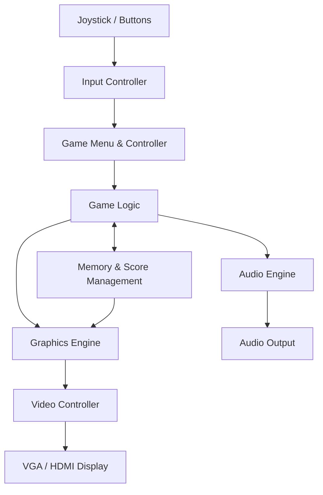

# Arcade OS

An FPGA-based arcade gaming system designed and implemented entirely using Verilog HDL.

## Overview

Arcade OS is a hardware-based arcade gaming console featuring ten classic arcade games accessible through an interactive game selection menu.

Players can navigate the menu using directional buttons or a joystick, select a game, play it, and return to the main menu.

The system implements game logic, graphics rendering, player input processing, collision detection, score management, and sound generation directly in digital hardware, without requiring a general-purpose processor or a conventional operating system.

## Features

- Interactive arcade game selection menu.
- Ten classic arcade games.
- VGA or HDMI display output.
- Joystick and button controls.
- Hardware-based graphics rendering.
- Bitmap font and sprite rendering.
- Collision detection.
- Score and high-score management.
- Sound effects.
- Modular and reusable Verilog architecture.
- Processor-independent game execution.

## Arcade Games

| No. | Game |
| --- | --- |
| 01 | Pong |
| 02 | Breakout |
| 03 | Snake |
| 04 | Tic-Tac-Toe |
| 05 | Racing |
| 06 | Flappy Bird |
| 07 | Tetris |
| 08 | Space Invaders |
| 09 | Pac-Man |
| 10 | Platformer |

## Hardware Specifications

| Parameter | Specification |
| --- | --- |
| Development Board | Sipeed Tang Primer 20K |
| FPGA Manufacturer | Gowin Semiconductor |
| Part Number | `GW2A-LV18PG256C8/I7` |
| Series | GW2A |
| Device | GW2A-18C |
| Package | PBGA256 |
| Speed Grade | C8/I7 |
| Hardware Description Language | Verilog HDL |
| Development Environment | Gowin EDA |

## System Architecture

The system is designed around independent hardware modules responsible for game execution, display generation, input processing, memory management, and audio generation.

## Development Roadmap

- [ ] System architecture design
- [ ] Video signal generation
- [ ] Graphics rendering engine
- [ ] Bitmap font rendering
- [ ] Sprite rendering engine
- [ ] Joystick and button controller
- [ ] Game selection menu
- [ ] Game state management
- [ ] Pong
- [ ] Breakout
- [ ] Snake
- [ ] Tic-Tac-Toe
- [ ] Racing
- [ ] Flappy Bird
- [ ] Tetris
- [ ] Space Invaders
- [ ] Pac-Man
- [ ] Platformer
- [ ] Audio engine
- [ ] Score and high-score management
- [ ] Hardware resource optimization
- [ ] System integration and testing

## Project Status

Under development.

---

**Built from the ground up with Verilog HDL and FPGA technology.**
